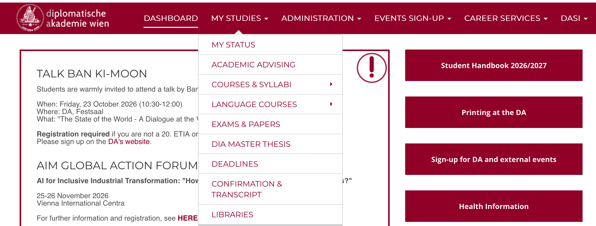
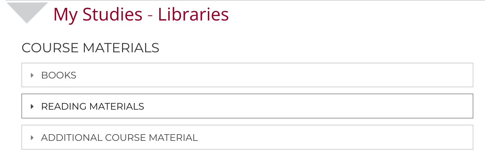
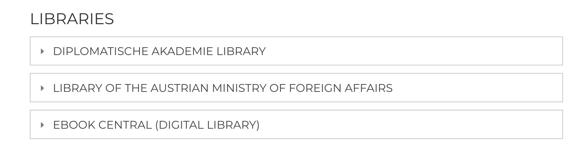

## Accessing the Libraries page

Follow these steps to access the Libraries page through your DA account.

### Step 1: Sign in to your DA account

Go to the [DA Service Portal](https://service.da-vienna.ac.at/) and sign in with your DA account.

Once you have signed in, follow the steps below.

:::: {.cr-section}

::: {#cr-libraries}
{fig-alt="The DA Service Portal showing the open My Studies drop-down menu, with Libraries at the bottom."}
:::

### Step 2: Open My Studies

In the navigation bar at the top of the page, click My Studies to open the drop-down menu. @cr-libraries

The menu displays several options.

### Step 3: Select Libraries

Look at the bottom of the drop-down menu and select Libraries. @cr-libraries

::::

### Step 2: Course & Reading Materials

Once you are in the Libraries section, here is a quick guide to finding your textbooks, syllabus readings, and lecture slides!

:::: {.cr-section}

::: {#cr-menu2}
{fig-alt="The DA Service Portal menu showing course and reading materials options."}
:::

:::{focus-on="cr-menu2"}
:::{.sage-box}
### 1. Books

- **Where to find them:** Hard copies of essential books are available at both the **DA Library** and the **MFA Library**.
- **Details:** See the "DA Libraries" section below for details on opening hours and borrowing!
:::
:::

:::{focus-on="cr-menu2"}
:::{.sage-box}
### 2. Reading materials

- **Reading Priorities:** Your course convenor will clearly label readings in the syllabus as *fundamental*, *mandatory*, or *optional* so you know what to read first.
- **Digital Copies:** You can access all digital readers on the **DA Intranet** (next to the syllabus) and on your course's **Moodle** page.
- **Printing:** Feel like reading on paper? You can easily print out course readers using the DA campus printers or print them at home.
:::
:::

:::{focus-on="cr-menu2"}
:::{.sage-box}
### 3. Additional course materials

- **Moodle Hub:** PPT slides, info sheets, and any extra resources shared by your professors are always uploaded directly to your course **Moodle** page.
:::
:::

::::

### Step 3: DA Libraries & Electronic Resources

Once you navigate to the **Libraries** page, you can access both physical collections and digital libraries. Here is a student-friendly guide to using the **DA Student Library**, the **MFA Library**, and **Ebook Central**.

:::: {.cr-section}

::: {#cr-menu3-detail}
{fig-alt="The DA Service Portal menu showing options for DA Library, MFA Library, and Ebook Central."}
:::

:::{focus-on="cr-menu3-detail"}
:::{.sage-box}
### 1. Diplomatische Akademie Library (DA Student Library)

The **DA Student Library** features an open-stack collection containing core course textbooks alongside key works in Economics, History, International Relations, Law, Environmental Studies, Digital, and Cultural Studies.

- **Location:** Reading Room, 1st Floor (next to the Finance Department).
- **Opening Hours:** Monday–Friday, 1:00 PM – 5:00 PM.
  > *Need a book urgently outside opening hours?* Stop by the Academic Administration Office on the 1st floor during standard work hours or email **bibliothek@da-vienna.ac.at**.

- **How Borrowing Works:**
  * **Limit:** You can borrow up to **6 books** at a time (you can borrow more once previous books are returned).
  * **Searching:** Search the available collection directly via the online catalog: [SEARCH HERE](https://davienna-my.sharepoint.com/:x:/g/personal/ruimeng_zhao_da-vienna_ac_at/IQCegUOe9Wk5Q7_il-Mo54gVASlSh_SfJke35yXdUkbt59g).
  * **Returns:** Return books directly to the DA Library during open hours or to the Academic Administration Office.
  * **Shelf Care:** Always return books to their proper place!  
    *(Example DA call number format: `LAW-Maxm-1.1-01Ex`)*
:::
:::

:::{focus-on="cr-menu3-detail"}
:::{.sage-box}
### 2. Library of the Ministry for Foreign Affairs (MFA Library)

The **MFA Library** offers specialized literature on European/foreign policy, diplomacy, international law, human rights, and global economy, as well as language dictionaries and past DA Master’s theses.

- **Staff & Seminar Room Location:**
  * **Librarian Offices:** 1st Floor along the long corridor (next to the lounge area).
  * **Current Books & Textbooks:** Housed in open-stack collections inside the new seminar rooms along the long corridor.

- **Office Hours:**
  * **Monday – Thursday:** 9:00 AM – 4:00 PM
  * **Friday:** 9:00 AM – 2:30 PM  
  *(Note: Opening hours may vary on public holidays and school breaks.)*

- **How to Borrow Books:**
  1. **Search the Catalog:** Browse topics via the MFA Library’s online catalog.
  2. **In-Person Requests:** For books shelved in the seminar rooms opposite the Librarian’s Office, submit your loan request in person. *Removing books without prior approval is strictly prohibited.*
  3. **Email Orders:** Click *"Available in the Foreign Policy Library of the BMEIA"* in the catalog to email your order (**aussenpolitische.bibliothek@bmeia.gv.at**), quoting the call number, title, author, and year. You will receive an email confirmation when your books are ready.
  4. **Pick-up & Returns:** Use the collection and return boxes located in the library corridor in front of the study room entrance.

- **Borrowing Terms:**
  * **Limits:** Up to **6 books** for a **3-week loan period** (extensions are possible).
  * **Returns:** Always hand returned books to a staff member or place them in the return box to avoid misplacement.  
    *(Example MFA call number format: `58.243C`)*
:::
:::

:::{focus-on="cr-menu3-detail"}
:::{.sage-box}
### 3. Ebook Central

**Ebook Central** is your digital library portal, providing full-text access to scholarly ebooks, handbooks, and research manuals across a broad range of subjects.

- **What is it good for?**
  * **Remote Access:** Read full-text ebooks and individual chapters from any internet connection.
  * **Research Tools:** Easily highlight text, take personal notes, export precise bibliographical citations, and share research with peers.

- **How to Use Ebook Central:**
  1. **Access Account:** To access your Ebook Central account, please click [here](https://ebookcentral.proquest.com/auth/lib/dalib-ebooks/login.action?returnURL=https%3A%2F%2Febookcentral.proquest.com%2Flib%2Fdalib-ebooks%2Fhome.action).
  2. **Browser Tip:** The link opens in a new tab. If you see an error after consenting to cookies, simply return to the portal page and click the link a second time.
  3. **Get Started:** Check out the *"How-to Videos"* and *"FAQs"* on the Ebook Central homepage to make the most of its features!

- **Feedback & Questions:**  
  Suggestions or questions about Ebook Central are always welcome! Reach out to the **DA Student Library** at **bibliothek@da-vienna.ac.at**.
:::
:::

::::